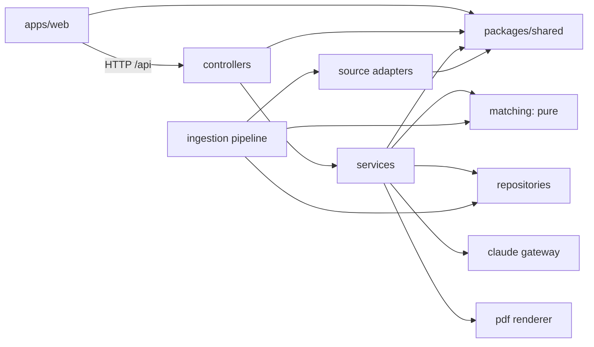
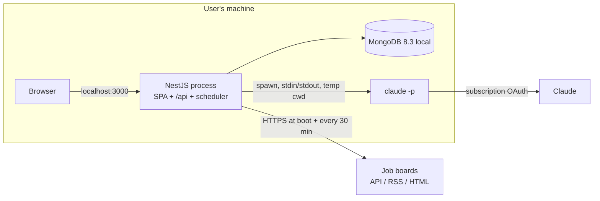
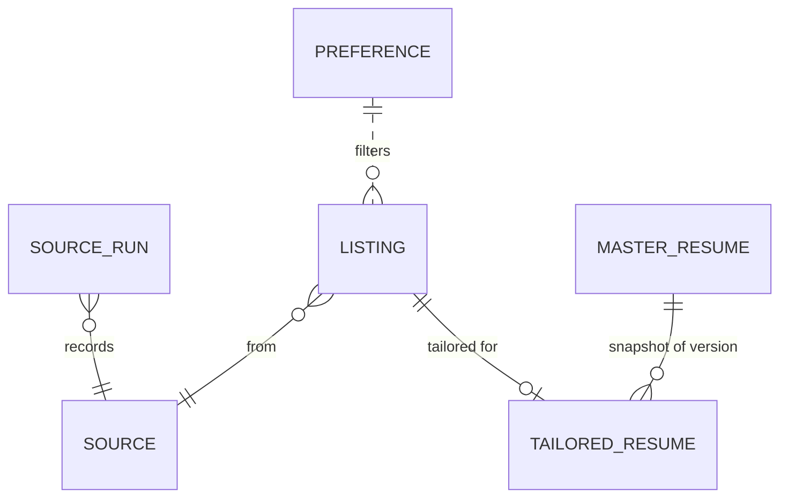

# Architecture Spine — AI Job Search v1

## Design Paradigm

A **modular monolith**: one NestJS process owns all modules and all writes. External systems (job boards, Claude Code, the PDF engine) sit behind **ports with adapters**. Ingestion is a **pipes-and-filters** chain: each stage is a pure step except the last, which persists.

| Layer | Directory | Holds |
| --- | --- | --- |
| Web (UI) | `apps/web` | React SPA; talks only to `/api` |
| API modules | `apps/api/src/<module>` | controller → service → repository per module |
| Domain logic | `apps/api/src/matching` | pure functions, no IO |
| Adapters | `apps/api/src/sources/adapters`, `apps/api/src/claude`, `apps/api/src/resume/pdf` | the only code that touches the outside world |
| Contract | `packages/shared` | zod schemas and inferred types |



Dependency rule: arrows point the only allowed way. `matching` and `adapters` never import repositories, Mongoose, or another module's providers.

## Invariants & Rules

### AD-1 — One process, scheduler in-process

- **Binds:** R2, C1, all modules
- **Prevents:** a second worker with its own write path or its own copy of the rules, and overlapping fetch runs.
- **Rule:** A single NestJS process serves the built SPA (`@nestjs/serve-static`), `/api`, and the fetch schedule (`@nestjs/schedule`, `FETCH_INTERVAL_MIN`, default 30). A run starts at boot and then on every interval. Runs are single-flight: a tick that arrives while a run is in progress is skipped. Fetching happens only while this process runs. No other process writes to MongoDB. `[ASSUMPTION]`: settles the ticket's open question in favour of "fetch only while the app runs".

### AD-2 — Sources are adapters behind one port, emitting one shape

- **Binds:** R1, R3, R8, C5
- **Prevents:** source-specific persistence, tagging or scoring hidden inside one board's code, and adapters each inventing their own listing fields.
- **Rule:**
  - Every board is one adapter in `sources/adapters/<source-id>.adapter.ts` implementing `JobSource { id: SourceId; eligibilityHint?: Eligibility; fetch(since: Date | null): Promise<ListingDraft[]> }`.
  - `ListingDraft` is a zod schema in `packages/shared`: `{ sourceJobId, url (required, absolute), title, company, descriptionHtml, locationText: string | null, locationTags: string[], postedAt: Date | null }`.
  - Adapters fetch and map to `ListingDraft`; they never persist, tag, score, sanitize, or call another adapter.
  - `eligibilityHint` is the board's known default; for example, `onlinejobs-ph` is `ph-friendly`.
  - An adapter that fails throws. The pipeline records the failure and carries on with the other sources.
  - A source is added to the `SOURCES` registry array in `sources/sources.module.ts` only after the source spike marks it usable.

### AD-3 — The ingestion pipeline is the only writer of listings

- **Binds:** R2, R3, R6
- **Prevents:** same-source duplicates, freshness drifting on refetch or repost, tags going stale after rule edits, and two owners of the `listings` schema.
- **Rule:**
  - `ingestion` owns the `listings` Mongoose schema and is its only writer. Every other module reads through `ListingsReader`.
  - Per source, the pipeline runs: `fetch(since = source_runs.lastSuccessAt) → validate ListingDraft → sanitize descriptionHtml (one allowlist sanitizer) → derive text → tagEligibility → extractSkills → upsert`.
  - The upsert is one atomic `updateOne({source, sourceJobId}, …, {upsert: true})` with a unique index on that pair:
    - `$setOnInsert` sets `firstSeenAt`, `postedAt` and `effectiveDate`. These never change after insert.
    - `$set` updates `title`, `company`, `descriptionHtml`, `url`, `locationText`, `locationTags`, `eligibility`, `skills`, `rulesHash` and `lastSeenAt`.
  - `effectiveDate = postedAt` when `postedAt` is non-null, not in the future, and not later than `firstSeenAt`. Otherwise `effectiveDate = firstSeenAt`.
  - Each run writes one `source_runs` record per source: `{source, startedAt, finishedAt, ok, count, error}`.
  - At boot, if the hash of the `matching/data/*.json` files differs from the `rulesHash` stored on listings, ingestion re-derives `eligibility` and `skills` for every listing.
  - Listings with `lastSeenAt` older than `RETENTION_DAYS` (default 30) are deleted at the end of a run.

### AD-4 — Eligibility and matching are pure and rule-driven

- **Binds:** R3, R4, R5, R7, R13, C3
- **Prevents:** LLM calls in the feed, two synonym tables disagreeing, scores going stale after the resume changes, and the feed breaking when inputs are missing.
- **Rule:**
  - `matching` exports pure functions only:
    - `tagEligibility({ locationText, locationTags, text, hint }) → 'worldwide' | 'apac' | 'ph-friendly' | 'restricted' | 'unknown'`.
    - `extractSkills(text) → SkillId[]`, where a listing's text is its title plus the sanitized description as plain text.
    - `matchScore(jobSkills, resumeSkillSet) → number | null`.
  - Eligibility precedence, most reliable first: structured `locationText`/`locationTags`, then the source `hint`, then phrases in the description. Within a level, `restricted` beats every other tag.
  - Rules live only in `matching/data/eligibility-rules.json` and `matching/data/skills.json` (canonical `SkillId` → synonyms).
  - `matchScore` returns `null` when `jobSkills` is empty or there is no confirmed resume. Otherwise it returns `round(100 × |jobSkills ∩ resumeSkillSet| / |jobSkills|)`.
  - Scores are computed when the feed is read and are never stored.
  - **Feed query** (`GET /api/feed`, always 200):
    1. Keep listings whose eligibility is not `restricted`.
    2. Apply the preference (AD-9).
    3. Compute each score.
    4. Drop listings whose score is not `null` and is below `minMatch`.
    5. Group into tiers by `effectiveDate`: `fresh` for 24h or less, `recent` for more than 24h and up to 72h, `older` for more than 72h.
    6. Sort each tier by score, descending, with `null` last, then by `effectiveDate`, descending.
  - The response carries `resumeStatus: 'none' | 'draft' | 'confirmed'`, and each item carries its `eligibility` and `score`.

### AD-5 — One Claude gateway, isolated

- **Binds:** R9, R11, C2, C6
- **Prevents:** bulk or paid Claude use, unvalidated output reaching the database, and Claude getting tools, MCP servers, files, or a saved transcript of the resume.
- **Rule:**
  - `claude/claude.gateway.ts` is the only code that spawns the `CLAUDE_BIN` binary.
  - Every call is `claude -p --tools "" --strict-mcp-config --no-session-persistence --permission-mode dontAsk --system-prompt <task prompt> --output-format json --json-schema <schema>`.
  - Input goes on stdin. The process runs from a fresh empty temp directory, with `ANTHROPIC_API_KEY` removed from its env, and is killed after 120 s.
  - Success requires exit code 0, `is_error: false`, and a `structured_output` field that passes the matching zod schema. Anything else is an error and nothing is saved.
  - Error codes returned to the UI: `422 claude_invalid_output`, `429 claude_usage_limited`, `503 claude_unavailable`, `504 claude_timeout`.
  - Calls are serialized: one runs at a time, and a waiting HTTP request blocks on the queue.
  - The gateway is called only from user-initiated endpoints (`POST /api/resume/parse`, `POST /api/listings/:id/tailor`), never from the scheduler or ingestion.
  - At boot, the gateway checks `claude --version` matches the pinned CLI version and logs a warning on mismatch.

### AD-6 — One master resume, versioned, draft then confirmed

- **Binds:** R9, R10, R13
- **Prevents:** matching or tailoring from an unreviewed parse, a re-upload breaking the working resume, and three incompatible meanings of "skill".
- **Rule:**
  - `master_resume` holds two slots, `confirmed` and `draft`, each nullable. Each slot is a `MasterResume { version, summary, skills: [{id, label, skillId | null}], experiences: [{id, company, title, start, end, bullets: [{id, text}]}], projects: [{id, name, bullets: [{id, text}]}] }`.
  - Upload: `unpdf` extracts the text in-process (AD-10), the gateway parses it, and the server assigns item ids with nanoid and maps each skill label to a `skillId` through `skills.json`. The result is written to `draft`. The PDF is not stored.
  - The review screen shows skills where `skillId` is `null`, so the user can rename or remove them.
  - Confirm moves `draft` to `confirmed` and increments `version`.
  - An edit to `confirmed` keeps every existing item id, gives new items new ids, and increments `version`.
  - Until a new draft is confirmed, the old `confirmed` slot stays in use.
  - `resumeSkillSet()` returns the set of non-null `skillId`s in `confirmed.skills`. Matching and the truth checks use only this function.
  - Tailoring with no `confirmed` slot returns `409 resume_not_confirmed`. The feed never does (AD-4).

### AD-7 — Tailoring returns structure; the server enforces truth

- **Binds:** R11, R12, C4, C6
- **Prevents:** invented skills, experience or numbers reaching a PDF, PDFs breaking when the master changes, and layout varying per call.
- **Rule:**
  - Tailoring sends the `confirmed` master and the listing's description text.
  - Claude returns `{ summary, skillOrder: skillItemId[], experiences: [{ id, bullets: [{ sourceBulletId, text }] }], projects: [{ id, bullets: [{ sourceBulletId, text }] }] }`.
  - **Truth checks.** The server rejects the result when any of these holds:
    - an `id` or `skillOrder` entry is not in the master;
    - a `sourceBulletId` is not in that same item;
    - `extractSkills` finds a skill in any text, including the summary, that is not in `resumeSkillSet()`;
    - a bullet contains a number (any digit sequence) that is absent from its source bullet;
    - the summary contains a number absent from the whole master.
  - On rejection, the response is `422 tailoring_rejected { violations }`. There is no automatic retry; the user may click again.
  - If `confirmed.version` changed while the call was running, the response is `409 resume_changed` and nothing is saved.
  - A passing result is stored as one `tailored_resume` per `listingId`. It is a full render snapshot: summary, ordered skill labels, experiences with company, title, dates and the tailored bullets, projects, `masterVersion` and `createdAt`. Re-tailoring replaces it.
  - The PDF is rendered on request from the snapshot alone, by one `@react-pdf/renderer` template in `resume/pdf`. Claude never produces layout.
  - A snapshot whose `masterVersion` is older than `confirmed.version` is returned with `stale: true`.

### AD-8 — The shared schema package is the contract

- **Binds:** all web↔api shapes, Claude output shapes
- **Prevents:** the SPA, the API and the Claude schemas drifting on field names or types.
- **Rule:**
  - Every request body, response, `ListingDraft`, `MasterResume` and Claude output is a zod schema in `packages/shared`. It is built to ESM with `tsc`, and both apps depend on it as `workspace:*`.
  - The API validates bodies with these schemas through Nest 12's Standard Schema support, not class-validator.
  - The JSON schema passed to `--json-schema` is generated from the same zod schema with `z.toJSONSchema`. Claude schemas use only types that survive this conversion: no transforms, refinements or dates; dates are ISO strings.
  - The API is REST JSON under `/api`.

### AD-9 — One active preference

- **Binds:** R5, R7
- **Prevents:** a second keyword table for preferences, and AND-versus-OR drift.
- **Rule:**
  - A single `preference` document `{ roleKeywords: string[], minMatch: number }`, with `minMatch` defaulting to 40.
  - A listing passes when **any** keyword matches.
  - A keyword that resolves to a `SkillId` through `skills.json` matches the listing's `skills`. Any other keyword matches the title, case-insensitively, on a word boundary.
  - An empty `roleKeywords` passes every listing.
  - `[ASSUMPTION]`: one preference at a time.

### AD-10 — Claude never touches files

- **Binds:** R9, C2
- **Prevents:** granting Claude filesystem access or sending it binary PDFs.
- **Rule:** PDF text is extracted in-process with `unpdf` and sent to the gateway on stdin. No path, file or tool is ever given to `claude -p`.

## Consistency Conventions

| Concern | Convention |
| --- | --- |
| Module system | ESM throughout (`"type": "module"`), from `nest new` with the ESM option |
| Naming | Files kebab-case with a Nest suffix (`listings.service.ts`); collections snake_case plural (`listings`, `source_runs`, `master_resume`, `tailored_resumes`, `preference`); source ids kebab-case (`remotive`, `we-work-remotely`, `onlinejobs-ph`) |
| Ids | Mongo ObjectId as a string over the API; resume item ids are nanoid strings assigned by the server |
| Dates | Stored as BSON Date, sent as ISO 8601 UTC strings; the UI shows local time |
| Errors | HTTP status + `{ error: { code: snake_case, message, details? } }` |
| HTML | Only sanitized `descriptionHtml` is stored; the web renders it through one `JobDescription` component |
| UI states | The `unknown` eligibility badge, the `resumeStatus` banner, and the `stale` tailored badge each have one shared component |
| Config | `.env` read through `@nestjs/config`: `MONGO_URI`, `FETCH_INTERVAL_MIN=30`, `RETENTION_DAYS=30`, `CLAUDE_BIN=claude`, `PORT=3000`; no secrets |
| Logging | Nest `Logger`, one context per module; one summary line per fetch run |
| Tests | Vitest in both apps. `matching`, the AD-7 checks and AD-3's date logic have unit tests. Adapters are tested against saved fixture payloads, never live boards. One smoke test checks the gateway's `system/init` event lists no tools and no MCP servers |

## Stack

TypeScript 7 is excluded on purpose: the Nest 12 CLI requires the TS 6 API.

| Name | Version |
| --- | --- |
| Node.js (LTS, `engines` `>=24.9`) | 24.22 |
| pnpm (workspaces, `packageManager`) | 12.23 |
| TypeScript | ~6.0 |
| @nestjs/core, @nestjs/platform-express | 12.6.3 |
| @nestjs/cli | 12.0.15 |
| @nestjs/schedule | 12.0.4 |
| @nestjs/mongoose | 12.0.2 |
| @nestjs/serve-static | 12.1.1 |
| @nestjs/config | 12.1.1 |
| mongoose | 9.13.1 |
| MongoDB (Homebrew, running) | 8.3 |
| vite | 8.4.0 |
| @vitejs/plugin-react | 6.3.0 |
| react | 19.3.1 |
| @react-pdf/renderer | 4.9.2 |
| unpdf | 2.2.3 |
| zod | 4.6.7 |
| nanoid | 6.0.2 |
| fast-xml-parser | 5.12.1 |
| Vitest | latest at scaffold, then pinned in lockfile |
| Claude Code CLI | 2.1.332 |

## Structural Seed





```text
ai-job-search/
  apps/
    api/src/
      sources/adapters/   # one file per board (AD-2)
      ingestion/          # pipeline, schedule, listings schema (AD-1, AD-3)
      matching/           # pure rules + data/*.json (AD-4)
      listings/           # feed + detail, read-only (AD-4)
      preference/         # AD-9
      resume/             # master, tailored, pdf/ template (AD-6, AD-7)
      claude/             # gateway (AD-5)
    web/src/              # React SPA
  packages/shared/        # zod schemas (AD-8)
```

Environments: local only. `pnpm dev` runs Nest in watch mode and the Vite dev server, which proxies `/api`. For daily use, `pnpm build && pnpm start` runs one process on `localhost:3000`. MongoDB runs as the Homebrew `mongod` service.

## Capability → Architecture Map

| Capability / Area | Lives in | Governed by |
| --- | --- | --- |
| R1 sources | `sources/adapters` | AD-2, C5 |
| R2 background refresh | `ingestion` | AD-1, AD-3 |
| R3 eligibility + unknown badge | `matching`, applied in `ingestion`; badge in `web` | AD-3, AD-4, UI states |
| R4, R5 tiers, min match | `listings` feed query | AD-4, AD-9 |
| R6 effective date | `ingestion` | AD-3 |
| R7 preference | `preference`, `listings` | AD-9 |
| R8 job detail + apply link | `listings`, `web` | AD-2 (`url` required), HTML convention |
| R9, R10 master resume | `resume`, `claude` | AD-5, AD-6, AD-10 |
| R11 tailoring | `resume`, `claude` | AD-5, AD-7 |
| R12 PDF download | `resume/pdf` | AD-7 |
| R13 match uses resume | `listings` → `matching` | AD-4, AD-6 |
| C7 time box | build order | Deferred: cut order |

## Deferred

- **Cut order for the two-week box (C7):** the tracer path runs on one API source first, then the other API and RSS sources. HTML-scraped sources are cut first if time runs short. Sofia orders the stories to match.
- **Per-source strategy (API, RSS or HTML):** the source spike in the feed epic decides it. AD-2 already fixes the shape.
- **Cross-source duplicates** (the same job on two boards): v1 shows both. AD-3 covers same-source duplicates only.
- **UI component library and styling:** one SPA and one builder, beyond the shared components above.
- **Exact eligibility phrases and skill synonyms:** these are data in AD-4's files. AD-3's `rulesHash` re-derives tags when they change.
- **MongoDB backups:** listings can be fetched again, and the master resume can be parsed again from the user's PDF.
- **Notifications, application tracking, embeddings, auth, hosting:** out of v1 per the initiative's Boundaries. AD-1's single process is where notifications would attach later.
